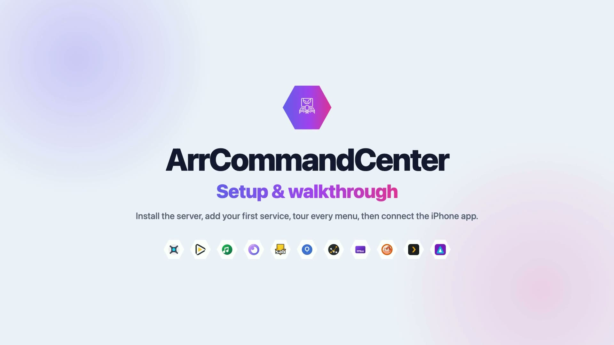

# Setup & walkthrough video

**[▶ Watch the video (tutorial.mp4, 5½ min, 1080p)](tutorial.mp4)**

A start-to-finish tour: install the server, add your first service, every
menu, the settings, then the iPhone app in both server and local-only mode.

## Chapters

| Time | Chapter | What you'll see |
|---|---|---|
| 0:00 | Intro | What the video covers |
| 0:12 | 01 · Install | `git clone`, `npm install`, an empty `config.json`, `npm start` |
| 0:36 | 02 · Add a service | Settings → **+ Add service**: key, label, type, URL, API key → Save. It's online right away, no restart |
| 1:26 | 03 · Overview | Service hexes, the activity feed, Upcoming |
| 1:54 | 04 · Library | Hex, List and Table views, sorting, filters, and the Calendar, Wanted, Queue, History and System tabs |
| 2:35 | 05 · Details & search | Title details, global search, the notification bell |
| 2:59 | 06 · Settings | Theme and accent, favorites, alert categories, adding an ntfy channel, services, diagnostics |
| 3:52 | 07 · iPhone app | Connect to your server, browse, title details, queue, the swipe-up sheet, app settings |
| 4:49 | 08 · Local-only mode | No server: add Sonarr on the phone, Test, Save, and the library loads directly |
| 5:23 | Outro | |

## Notes

- The service in the video is a **mock Sonarr** with sample titles. Use your
  real service's URL and API key. Point it at an address the server can
  reach, such as a LAN IP, a hostname or an `https://` URL.
- The browser chapters were recorded from a fresh, non-demo install. The
  terminal scene uses the real startup output.
- The iPhone chapters were recorded in the iOS Simulator with the actual app.
- There's no audio; everything is captioned on screen.
